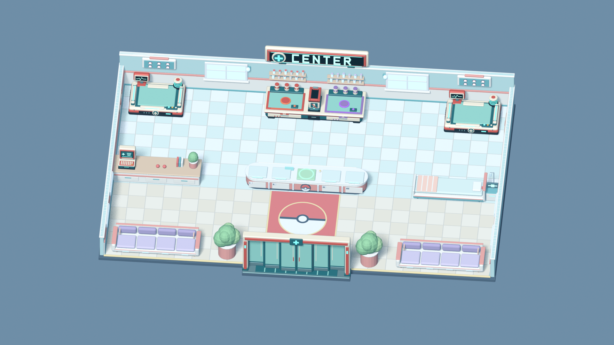

# MVP visual assets

This is the working art guide for the first Pokémon Center. The [editable visual pilot](visual-pilot.svg) is an original, self-contained composition used to evaluate scale, palette, station recognition, and HUD density at the minimum 1280 × 720 viewport. Its dashed boxes mark positions for PMD sprites; the pilot contains no character artwork.

## Baseline and scale

The standalone menu uses the [layered twilight v2 art pack](../art/source/menu-clinic-layered-v2/README.md): six registered 1672 × 941 layers for landscape, clouds, rear pine grove, clinic/ground, foreground trees and smoke. Source PNGs, prompts, an editable OpenRaster document and a draw-order manifest live in the pack. Runtime WebP exports use quality 90 with lossless alpha; the composed `preview.webp` is the still fallback. The original v1 illustration and clean plate remain source references, not runtime inputs.

The canvas draws landscape → clouds → flying Pokémon → rear pine grove → clinic and light glows → ground Pokémon → foreground trees → smoke. This uses authored alpha silhouettes instead of extracting color regions or estimating a skyline. Lugia passes behind the rear grove as well as the clinic and foreground trees. Near-opaque interiors of the clinic and both tree layers become fully opaque during preparation, while transparent gaps and soft branch edges are retained. The painted cloud tile matches the original illustration with muted mauve colors and thin, irregular wisps. Its three strips scroll continuously to the right, traversing the full 1672-pixel artwork width every 170, 270 and 420 seconds. Two native-size adjacent copies per strip wrap modulo the tile width. Complete cloud silhouettes and verified transparent side gutters prevent a visible join; the reset is pixel-equivalent to ordinary forward scrolling. Six staggered smoke plumes rise, grow and fade from the new chimney at (250, 160); eight lamp glows use the new artwork coordinates. Trees and flowers remain still in this variant; the v1 foliage masks are not applied to the new composition.

Chansey waits beside the steps, Meowth walks on the lower path, and arriving patients follow the new route to the door at (563, 615). Both airborne and ground Pokémon are drawn behind framing trees. A shared cover transform keeps all scene layers aligned on desktop and narrow screens. The menu pauses outside visible menu screens and in hidden tabs, caps painting at 30 fps, and retains its pause/resume button. Reduced motion or a missing/invalid layer uses the matching composed still. No additional runtime dependencies or third-party assets were introduced. Original source and export details are in the pack README.

The title logo has an original illustrated wordmark with a medical bag, heart, lightning accent and stethoscope: [PNG source](../art/source/pokecenter-panic-logo.png), [prompts and export command](../art/source/pokecenter-panic-logo.prompt.md), and [WebP runtime asset](../apps/client/public/assets/original/pokecenter-panic-logo.webp). Both files are 1774 × 887 with alpha transparency; the WebP is 240,422 bytes at quality 92 with lossless alpha. The same local image is reused by the large entry-screen heading and compact home link. Explicit intrinsic dimensions reserve its space, a descriptive image alt labels the main heading, and responsive widths preserve its aspect ratio. The former text-only title and separate sticker are removed. No external font or logo library is required.

The game uses a 960 × 540 logical presentation space, a 48-pixel logical tile, and `Phaser.Scale.FIT`. The drawing buffers adapt to the fitted display size and device pixel ratio, with a 960 × 540 minimum and 3840 × 2160 cap. Global pixel-art mode is disabled; sprite textures retain nearest-neighbor filtering. Shared movement geometry and interaction points remain independent of render density. The pilot has been rendered at 1280 × 720; final browser validation must still include all PMD sprites, Chrome and Firefox, and a complete round.

Character sprites come from the existing PMD importer and its ignored local cache. We create the scenario art ourselves. The first editable environment source is [`art/source/center-map.svg`](../art/source/center-map.svg). Its 960 × 540 [composite preview](../apps/client/public/assets/original/center-map.png) is exported as separate [floor](../apps/client/public/assets/original/center-floor.png) and [fixture](../apps/client/public/assets/original/center-fixtures.png) textures for the optional 2D view. The default 3D view builds original geometry in code and uses the same server layout. PMD source rights and credits still require review before a public build.

The 2D comparison art uses square edges, dark outlines, and stepped highlights. The playable 3D center uses rounded, low furniture in a limited palette so the enlarged PMD pixels remain legible. Reception cots, healing beds, medicine preparation, waiting bays, and recovery have distinct silhouettes. The floor texture stays low contrast. Station footprints remain shared with the server map.

## Playable hybrid 3D center

The playable game draws an original 3D center beneath the Phaser HUD. Lit floor, walls, counters, beds, and machines provide depth; enlarged PMD sprites stand on vertical planes that rotate only around the room's up axis. The fixed camera shows the whole room. Every station mesh is checked against its shared 960 × 540 collision footprint, and the visible room border follows the walk bounds. The player collision width covers the widest enlarged staff PMD frame; healing machines are reached from the front or the open side. Server movement resolves to within a fraction of a pixel of an obstacle boundary, and the client does not interpolate through blocked space. The PMD sheets are read from the ignored local cache at runtime and fall back to markers when absent. Visit the normal client URL to play in 3D, or add `?render=2d` to compare the previous rendering.

The [geometry preview](../apps/client/preview-3d.html) remains available for inspecting the room by dragging the camera. The playable view adds live multiplayer character positions, directional Idle and Walk frames, medicine bottles, carried-patient stretchers, and interaction markers. The 3D art is still a visual pilot: richer original textures, state-specific machine effects, character-wide overlap checks, and performance testing at 1280 × 720 remain.

The carried-patient stretcher and generic medicine bottle also have original SVG sources in [`art/source`](../art/source) and matching PNG exports in [`apps/client/public/assets/original`](../apps/client/public/assets/original). The bottle uses a visible B or A condition mark, so its identity does not depend on color. Both are composited with the PMD sprites at native pixel size.

The original HUD icons represent injury healing, burn, poison, completed treatment, and discharge readiness. The focused or carried patient's two-line checklist names only pending care after `NEEDS:`, or states `ALL TREATMENTS COMPLETE`, without imposing an order. The full patient name, HP, patience percentage, remaining seconds and patience bar share the bottom patient file. Healing and medicine preparation also show progress bars beside their stations, synchronized with server timers. The HUD does not hide the fixed map; icon shapes and text convey state without relying on color or sound.

On macOS, run `npm run assets:original` after editing the SVGs. The exporter uses the marked floor and fixture sections in `center-map.svg` to regenerate both runtime layers and the composite preview. The asset test checks that every tracked PNG matches its source.

For local visual QA, the development client accepts `?artFixture=` with `heal`, `burn`, `poison`, `ready`, `rejected`, `healing`, `outage`, `repair`, `preparing`, or `roster`. These synthetic states render the real map and UI at browser size, using the ignored local PMD cache when available. They do not alter the server or appear in production builds. The outage and repair fixtures preview graphics for the incident gameplay specified in section 6.1; that gameplay is not yet implemented in the prototype server.

PMD frame sizes in the locally generated manifest are not uniform:

| Species | Idle frame | Walk frame |
| --- | ---: | ---: |
| Pikachu | 40 × 56 | 32 × 40 |
| Bulbasaur | 32 × 40 | 40 × 40 |
| Charmander | 32 × 40 | 32 × 32 |
| Squirtle | 32 × 32 | 32 × 32 |
| Eevee | 24 × 32 | 40 × 48 |
| Psyduck | 24 × 40 | 24 × 40 |
| Chansey | 24 × 40 | 24 × 32 |
| Audino | 32 × 48 | 32 × 48 |
| Machoke | 32 × 48 | 32 × 48 |
| Meowth | 32 × 32 | 24 × 32 |

The playable 3D view displays each PMD frame at 2.5 times its source size relative to the 48-pixel logical tile, with feet anchored to server positions and the original aspect ratio preserved. Nearest-neighbor sampling preserves the PMD pixels. Vertical planes prevent the upper pixels from leaning into furniture as the camera looks downward. They use the 3D depth buffer, so furniture hides the parts that pass behind it. An elliptical floor ring shows the player collision footprint. The 2D comparison view retains native scale, but shares the wider authoritative player collision body.

The pilot palette uses dark navy `#0a1c2e` for HUD panels, deep teal `#345e68` for walls, pale mint `#c6dbcf` for the floor, warm cream `#f2d3a1` for counters, cool blue `#729fb4` for healing, and lavender `#bbaec5` for waiting. Status icons must have distinct silhouettes and short text labels; color remains a secondary cue. The HUD uses the built-in Trebuchet MS/sans-serif stack for headings and patient details, alongside monospace status text. No font files are distributed; review source, license and readability before adding any external font.

## Blender healing machine

The first original Blender model is [healing-machine.blend](../art/source/healing-machine.blend),
with a [GLB export](../apps/client/public/assets/original/models/healing-machine.glb),
[preview](../art/previews/healing-machine.png), and
[asset manifest](../art/source/healing-machine.json). The playable 3D center and
standalone 3D preview load this model once and share its geometry and materials
between both stations. Each station owns separate copies of its two emissive light
materials so status changes cannot leak to the other station. Procedural beds remain visible during loading or if the GLB
is unavailable; scene teardown also releases a late-loading asset safely.

The cream/coral chassis, mint mattress, pulse monitor, power pod, and illuminated rails
use original geometry and solid materials with no external textures or fonts. The
Blender scene keeps 69 editable parts in `HealingMachine - Editable Parts`; the studio
collection is only for previews. The GLB bakes the modifiers and groups geometry by
material into 10 meshes, 10 materials and 14,060 triangles (455,944 bytes).

Place `HealingMachine` at the station center with no scale or rotation adjustment:
the GLB uses Y up and faces +Z. `PatientAnchor` is at `(0, 0.66, 0)`, on the mattress.
Its bounds fit both shared station rectangles. `StatusGlow` and `ScreenTrace` are
separate named meshes animated by the runtime from the authoritative machine status.
Empty uses dim teal, treating pulses blue every 1.6 seconds, completed stays green,
and broken flashes red for 350 ms every 1.2 seconds. The monitor trace follows the
same state. Only the left station has a server machine; the right station stays idle. After editing the source, apply evaluated modifiers
to export copies, join by material, and export only that selected hierarchy in the
active scene as GLB. Preserve the editable source and exclude the studio.

`scripts/healing-machine-asset.test.ts` loads the actual GLB through Three.js and
checks station bounds, the patient anchor, export isolation and asset budgets.
`healingMachineModels.test.ts` checks replacement, resource sharing and disposal,
failed or interrupted loads, and placement of the real GLB in both station footprints.
The existing Phaser treatment/progress/repair overlays still display server state.
Use `?artFixture=healing`, `?artFixture=healed`, and `?artFixture=outage` in the
development client to inspect the three active light states with Pikachu and Chansey.
`?artFixture=repair` retains the red warning until the server clears the breakdown.
Automated checks cover the actual GLB materials, pulse/blink timing, station isolation,
pre-load status updates, transitions back to idle, and disposal of cloned materials.

## Blender medicine table

The original [medicine-table.blend](../art/source/medicine-table.blend) contains a
standalone editable asset scene and studio, with 83 mesh parts. Its
[GLB](../apps/client/public/assets/original/models/medicine-table.glb),
[preview](../art/previews/medicine-table.png), and
[manifest](../art/source/medicine-table.json) accompany the source.
The cream/coral/teal cabinet matches the healing machine; coral Burn Heal and lavender
Antidote trays have reagent racks, shallow mixing wells, B/A marks made from geometry,
and a shared central disposal opening. All geometry and materials are original;
there are no external textures or fonts. Reagent bottles are decorative stock;
prepared doses still use the authoritative dose entities and existing surface points.

The GLB uses Y up, faces +Z, and sits at the shared medicine obstacle center without
scaling. Its bounds fit the 276 × 102 pixel collision rectangle. `BurnHealAnchor`,
`AntidoteAnchor`, and `DisposalAnchor` lie at the front edge, at height 0.66, aligned
with the X coordinates of the corresponding shared interaction points. Export only
the active scene's selected model hierarchy, evaluating modifiers and joining meshes
by material; exclude the studio. Runtime budget: 11 meshes, 11 materials, 10,372
triangles, and 404,012 bytes.

Both the game and orbit preview replace the procedural table after loading succeeds.
A failed load retains the fallback; teardown disposes the model or a late load safely.
The asset and integration tests parse the actual GLB to check isolation, budgets,
collision bounds, interaction alignment, replacement, and disposal. The preparation
fixture and ten-character roster were inspected at 1280 × 720 with the new table;
the Pokémon and preparation prompt remained readable. Screenshots containing PMD
sprites stay outside the repository. `?artFixture=preparing` opens the focused preview.

`BurnHealGlow` and `AntidoteGlow` are independent emissive meshes for each preparation
button, mixing-well rim and short tray strip. The server's preparation owner per
medicine drives the animation: Burn Heal pulses coral every 1.2 seconds; Antidote
pulses violet every 1.8 seconds. Both can run simultaneously, then return to a dim
colored idle as soon as their owner clears (completion, cancellation or disconnect).
Animation never decides whether a dose is ready. `?artFixture=preparing-antidote`
and `?artFixture=preparing-both` expose the other visual checks. Tests load the real
GLB and verify spatial/material isolation, pulse timing, concurrent preparation,
pre-load state, return to idle and resource cleanup. The two-color preparation view
was inspected at 1280 × 720 with Chansey and Audino.

## Blender reception counter

The central island counter is generated by [`reception_counter.py`](../art/source/blender/reception_counter.py)
into [reception-counter.blend](../art/source/reception-counter.blend), its
[GLB](../apps/client/public/assets/original/models/reception-counter.glb),
[preview](../art/previews/reception-counter.png) and [manifest](../art/source/reception-counter.json).
A coral body with a cream band, white top and rounded ends gives the clinic its recognizable front desk.
Four numbered arrival pads flank a green discharge tray in the middle, with a ball medallion on the
front panel below it. The staff side has shelves with ball trays, a ledger screen and a service bell.
All detail is original geometry and solid materials; there are no textures or fonts.

`ReceptionGlow1` through `ReceptionGlow4` and the `DischargeGlow` ring keep independent emissive
materials. Empty bays glow dim teal, occupied bays pulse amber every 2.4 seconds and fully treated
patients pulse green every 1.4 seconds. The discharge ring pulses green while any active, located
patient is ready to leave. Visual animation never changes gameplay state.

The model sits at the shared counter center (336 × 68 pixels), uses Y up and faces +Z.
`ReceptionAnchor1` to `ReceptionAnchor4` and `DischargeAnchor` match the shared slot positions at the
0.93 patient elevation. Outer surfaces stop just inside the footprint so float32 export rounding
cannot exceed it. Runtime budget: 18 meshes, 18 materials, 9,192 triangles and 488,964 bytes. Tests validate bounds, anchors,
ray hits on `ArrivalPad` and `DischargeGreen`, budgets, light isolation and resource lifecycle.

## Blender waiting benches

The waiting seats are four-seat sofas generated by [`waiting_benches.py`](../art/source/blender/waiting_benches.py)
into [waiting-benches.blend](../art/source/waiting-benches.blend), with its
[GLB](../apps/client/public/assets/original/models/waiting-benches.glb),
[preview](../art/previews/waiting-benches.png) and [manifest](../art/source/waiting-benches.json).
Individual lavender seat cushions, deeper lavender back cushions, cream arms and shell, coral piping,
wooden legs and small coral throw pillows match the clinic palette. The runtime places two copies.

Seats are now symmetric about the sofa center: shared seat positions use `bench.x + 39 + 54 × index`.
`WaitingAnchor1` to `WaitingAnchor4` sit at the 0.5 patient elevation on the `SofaLavender` cushions.
Each seat has an independent `WaitingGlow` strip on the front rail with the same empty, occupied and
ready colors as reception. Staff reach a seat from behind the low back cushion. Runtime budget:
11 meshes, 11 materials, 3,092 triangles and 163,272 bytes.

## Recovery area model

The recovery bay is generated by [`recovery_area.py`](../art/source/blender/recovery_area.py) into
`art/source/recovery-area.blend`, `art/previews/recovery-area.png` and the `recovery-area` GLB and
manifest. It closes the right end of the counter row: a wheeled bed with a mint `MintCushion`
mattress, folded coral blanket, pillow and a headboard with a heart emblem against the side wall,
plus a bedside cabinet with the state monitor and a drip stand.

`RecoveryAnchor` matches `RECOVERY_POSITION` at the 0.57 patient height. `StatusGlow` stays dim teal
when empty, pulses amber while patients wait and pulses green only when the front patient is ready.
The monitor shows `ScreenTrace` while waiting and switches to the green `ReadyMark` on readiness.
Runtime budget: 14 meshes, 14 materials, 2,498 triangles and 142,392 bytes. The queue, single pickup point and indicators are unchanged.

## Transport stretcher model

The original Blender source is `art/source/transport-stretcher.blend`, with a
studio preview in `art/previews/transport-stretcher.png` and a runtime GLB under
`apps/client/public/assets/original/models/`. Cream rails, a mint mattress, coral
trim and rubber grips match the center furniture. `TransportAnchor` sits at local
height 0.11; the root follows the carried patient's position at height 1.17, placing
patient feet at the existing 1.28 height. The stretcher keeps its horizontal
orientation in every travel direction to stay within the carrier's collision
footprint, including its handles. During actual carrier movement, the runtime
adds up to 0.025 units of vertical lift and 0.018 radians of side tilt on a
0.8-second cycle. Movement starts smoothly and settles when the carrier stops.
The patient's contact point and sprite tilt follow the mattress, including
transparent padding in each PMD frame. Placement, teleportation and interrupted
frame clocks reset the sway. This changes presentation only; server positions
and collisions remain unchanged.

The game loads one template and creates independent groups with shared geometry
and materials for simultaneous carriers. The model replaces the provisional bed,
keeps each group's current position and visibility on arrival, disappears on
placement, and is released when its patient leaves the scene. Failed loads retain
a procedural stretcher. Only the template owner disposes shared resources;
late loads after teardown are discarded. The 2D view retains its existing sprite.

Budget: 6 meshes, 6 materials, 2,376 triangles and 87,948 bytes. Export only the
selected active-scene hierarchy, with evaluated modifiers and meshes joined by
material; omit the studio and all external resources. Tests check the actual GLB,
patient contact with the mattress, carrier footprint, multiple instances, movement,
placement, failed and late loads, and resource disposal. The
`?artFixture=transport-stretcher` preview shows Chansey carrying Pikachu in the aisle.
The `?artFixture=transport-sway` development preview walks across the aisle with
one-second pauses at either end. Tests verify motion bounds, frame-rate independence,
settling, resets and contact alignment while swaying.
Screenshots containing PMD sprites stay outside the repository.

## Medicine bottle models

The original editable sources are `art/source/burn-heal-bottle.blend` and
`art/source/antidote-bottle.blend`, with matching JSON manifests, studio previews
in `art/previews/`, and runtime GLBs under `apps/client/public/assets/original/models/`.
Burn Heal has a rounded square coral body, a broad cream cap and a raised B label.
Antidote has a tapered octagonal lavender body, a taller cap and a raised A label.
Both use the furniture's cream, teal and metal palette. Labels are original stroke
geometry; neither export contains fonts, textures, studio objects or animation.

Each root rests at local Y zero with its label facing +Z and a `BottleBaseAnchor`
at the origin. The runtime preserves the shared dose surface positions and uses
base heights of 0.04 on surfaces and 0.92 when carried. Every dose uses its server
medicine kind, including simultaneous carriers and reused IDs after a round reset.
Preparation, pickup, placement, application and disposal keep their existing rules.
The 2D view retains its original generic bottle sprite and treatment marks.

Carried bottles sway with actual carrier movement on a 0.8-second cycle, with
up to 0.06 radians of side tilt and 0.015 units of lift. The movement eases in
and settles when the carrier stops; surface doses remain upright and still.
Each bottle has independent motion state. Placement, pickup, carrier changes,
teleports and interrupted clocks reset it, and removal releases it. Loading the
GLB preserves the current pose. The reusable motion calculation also drives
stretchers with their original tilt and lift settings.
Use `?artFixture=medicine-sway` to view Chansey and Audino carrying the two kinds
along separate lanes with staggered pauses. Tests cover both bottle kinds,
settling, independent carriers, surface placement, transfers, loading, frame-rate
independence, resets and frame-clock delivery from the map scene.

One template loads per medicine kind; instances share geometry and materials.
Pending or failed loads retain procedural bottles. Loading replaces each fallback
without moving its instance. Removing one dose preserves the resources used by
other doses, and teardown also releases assets that finish loading late.

Both exports have 4 meshes and 4 materials. Burn Heal has 1,356 triangles and
58,348 bytes; Antidote has 1,224 triangles and 51,228 bytes. Tests check the actual
GLBs, bounds, anchors, budgets, independent load failures, resource lifetime,
surface-to-carrier transfer, changed kinds, invalid locations and removal.
The development preview `?artFixture=medicine-bottles` displays four surface doses
and both medicine kinds carried by Chansey and Audino. This was visually checked
in the in-app browser at 488 × 634; both GLBs loaded alongside the PMD sprites.
Screenshots containing PMD sprites stay outside the repository.

## Medicine disposal container

The original source is `art/source/medicine-disposal-bin.blend`, with a matching
JSON manifest, `art/previews/medicine-disposal-bin.png` and the runtime GLB under
`apps/client/public/assets/original/models/`. Its cream body, teal base, coral
opening and metal grips match the medicine station. An original raised bottle
and diagonal slash identify disposal without fonts or textures.

The container rests on the medicine table's central inset at height 0.705 and
local Z offset 0.22, aligned with `MEDICINE_DISPOSAL_POINT.x`. It fits inside the
existing station footprint and central strip without covering either preparation
area. The server emits `medicine:discarded` only after accepting a discard and clearing
ownership, with its round ID, dose ID and medicine kind. Every connected client
plays the same visual response once. Rejections, medicine application, disconnects
and resets do not emit the effect; clients ignore duplicates and stale rounds.
A 700 ms fall uses the matching bottle model, a slight tilt and a final shrink
into the shallow opening. `StatusGlow` flashes teal and returns to its idle glow.
The confirmed carried bottle is hidden immediately while its state removal is
in flight, preventing a duplicate. Temporary bottles share loaded resources and
are released on completion, clock resets, round stop or teardown. At most eight
effects can run concurrently. Loading either model preserves an active effect.
The existing disposal interaction and server ownership rules remain authoritative.
`MedicineDisposalAnchor` marks the front face. The old cabinet remains underneath.
The runtime owns the container and its procedural loading/error fallback, releases
both on teardown, and discards late loads safely.

Budget: 7 meshes, 7 materials, 1,864 triangles and 72,448 bytes. The export omits
studio objects and external resources. Tests check actual GLB bounds, anchors,
budgets, table support, interaction reachability, fallback and resource cleanup.
Use `?artFixture=medicine-disposal` to view Chansey carrying Burn Heal in front
of the discard point. The in-app browser check at 488 × 634 confirmed the model
loads alongside Chansey and displays the discard prompt.
`?artFixture=medicine-disposal-fx` alternates Burn Heal and Antidote drops every
2.4 seconds. Automated checks cover real GLB motion, light intensity, lifecycle,
pending state removal, duplicate and stale events, and a two-client server test
that observes one broadcast per accepted discard. Screenshots containing
PMD sprites stay outside the repository.

## Entrance door

The original editable source is `art/source/entrance-door.blend`, with its JSON
manifest, `art/previews/entrance-door.png` and runtime GLB under
`apps/client/public/assets/original/models/`. Cream posts, coral trim, mint glass
panels, metal grips and teal status strips match the center. Six independent
leaves telescope into the jambs, with a threshold made entirely from geometry.
The GLB and Blender preview store the closed pose. Each leaf is 0.92 units wide
and 2.28 units tall, closing against the jambs with a 0.01-unit central seam.
The 0.15-unit rail spacing keeps leaf frames and grips separate during movement.
The open stack stays inside the 6.16-unit footprint and leaves a 4.12-unit passage. Three leaves per side have
separate `EntranceLeafL0_Runtime` through `EntranceLeafR2_Runtime` groups. The full header and medical cross remain editable
and exported; `EntranceHeader_Runtime` is hidden in the gameplay cutaway so the
foreground beam does not obscure characters.

Placement uses the mean X of the four shared spawn points and the front walk
boundary plus 0.4 world units. The door's rear edge meets the existing boundary.
A matching shallow step supports the threshold outside the room, and the existing
front trim leaves a 6.16-unit gap. Walk bounds, spawn positions, collisions and
room transitions retain their existing behavior; this is an environment asset.
The loader keeps an animated procedural doorway on failure and releases both
installed and late-loading resources on teardown. A pending load inherits the
current opening pose.

The door opens when any staff avatar is within 3 units horizontally and 2.2 units
in depth of its center. An expanded 3.4 × 2.6-unit half-extent and a 350 ms delay
prevent oscillation at the sensor boundary. Opening takes 450 ms and closing
550 ms with smoothstep easing; returning staff immediately reverse a closing door.
Station patients do not trigger the sensor. Frame clocks drive the presentation,
with resets after interruptions. The geometry stays outside the walk boundary.

Both jamb beacons use the exported `StatusGlow` material. Closed leaves show warm
amber at 0.45 emissive intensity; open leaves show green at 1.1. Color and intensity
interpolate with the same eased opening fraction as the leaves, including a
reversal. Lights remain green during the close delay. The procedural fallback
has matching beacons and transfers the current light state when the GLB loads.
Tests cover both endpoint colors, intermediate brightness, delay, reversal,
clock resets, failed and pending loads, and material disposal.

Budget: 36 meshes, 6 materials, 5,184 triangles and 186,440 bytes. Tests check the
actual export, separate header, bounds, anchors, lifecycle, threshold support and
clear sight lines through the entrance at all four spawn positions. Motion tests
cover multiple staff, hysteresis, close delay, reversal, frame rates, clock resets,
pending loads, closed-frame fit, nonintersecting leaves across the opening stroke,
open passage width and teardown. `?artFixture=entrance-proximity` walks Chansey toward
the door, pauses, retreats and pauses again.
`?artFixture=entrance-door` previews Chansey, Audino, Meowth and Machoke at those
points. The 488 × 634 in-app browser check confirmed that the loaded doorway and
threshold leave all four characters visible. Screenshots containing PMD sprites
stay outside the repository.

## Luminous center sign

`art/source/center-sign.blend` contains the editable original sign and its studio;
the JSON manifest, `art/previews/center-sign.png` and
`apps/client/public/assets/original/models/center-sign.glb` accompany it. The sign
uses a cream housing, coral bezel, dark teal face, mint medical cross, geometric
`CENTER` lettering, narrow light rails and two metal mounting feet. No external
fonts, textures or other resources are used. `StatusGlow` and `ScreenTrace` retain
their emissive materials in the GLB. The game applies a synchronized four-second
cosine pulse to the lettering, cross and light rails, between 80% and 120% of their
original emissive intensity. Colors stay fixed and the lights never switch off.
Frame time drives the cycle without timers or additional dynamic lights. The
fallback pulses too, and a late GLB inherits the current phase. The sign has no
gameplay state.

`CenterSignModel` mounts the sign at the back wall crown (height 2.36), centered
on the room, facing the camera. Its 5.9 × 1.26 × 0.63-unit bounds fit inside the
gameplay camera without changing room collisions or station positions. The loader
retains a luminous medical-cross fallback on failure, disposes replaced geometry
and materials, and cleans up models that finish loading after teardown.

Budget: 39 editable meshes, 7 runtime meshes/materials, 4,884 triangles and
181,932 bytes. Asset tests verify the embedded buffer, bounds, anchor, emissive
materials and budgets. Runtime tests cover placement, camera framing, fallback,
late loading, pulse range, phase continuity, frame rates, clock reset and disposal.
`?artFixture=center-sign` shows four staff and six
patients; the 488 × 634 in-app browser check confirmed that the sign, characters
and HUD remain visible. Screenshots with PMD sprites stay outside the repository.

## Desktop PC terminal

`art/source/pc-terminal.blend` contains the original editable PC, with a JSON
manifest, `art/previews/pc-terminal.png` and a runtime GLB under
`apps/client/public/assets/original/models/`. Its cream monitor, coral bezel and
keyboard tray, teal base, front reader, vents and mint display symbols match the
other center equipment. All screen symbols and keys are geometry; no external
fonts or textures are included. `ScreenTrace`, `StatusGlow`, `ReaderGlow`, `ProgressGlow` and three `DataLine`
materials are independent emissive components, and `PcDeskAnchor` / `PcScreenAnchor` identify its support and
display. The terminal is a visual prop with no PC menu yet. Three left-aligned data rows
vary in length and brightness in a staggered 2.4-second cycle. The lower bar
breathes through its fill range every four seconds; the reader pulses every
1.2 seconds while the power indicator stays steady. Lights never go fully dark,
and all moving geometry stays inside the screen. Frame time drives the effect
without timers; the fallback and late-loaded model share the current phase.

`PcTerminalModel` stands at height 0.84 on the left end of the PC corner desk,
positioned from the shared `PC_CORNER_BOUNDS` footprint; the desk props occupy its
right half. The model measures 0.962 × 1.16 × 0.964 units. The desk is part of the
room shell and is a solid obstacle, so the PC adds no collision or interaction
points. Failed PC loads keep a lit procedural fallback;
teardown releases installed and late-loading geometry and materials.

Budget: 48 editable meshes, 14 runtime meshes/materials, 5,184 triangles and
186,516 bytes. Asset tests cover bounds, anchors, emission, self-contained export
and budgets. Integration tests raycast the desk top under the PC, check desk
clearance, framing, fallback, processing phase, screen bounds, clock resets,
frame rates and disposal; reception tests retain coverage for
all arrival/discharge indicators. `?artFixture=pc-terminal` shows the PC alongside
four staff and six patients. A 488 × 634 browser check confirmed placement and
readability, with its PMD-containing screenshot kept outside the repository.

## Blender floor and walls

The clinic shell is generated by [`center_room.py`](../art/source/blender/center_room.py) into
`art/source/center-room.blend`, its manifest, `art/previews/center-room.png` and
`apps/client/public/assets/original/models/center-room.glb`, exported in shared-map coordinates.

- **Floor:** mint and white checker tiles in the treatment area and warm cream tiles in the lobby.
  A four-tile red carpet runner leads from the entrance to the counter, with a flat ball medallion
  inset. Every walkable floor top stays at or below 0.013 so characters never float.
- **Walls:** the back wall stays 2.36 high, with two windows, wall lamps, a coral stripe and teal
  skirting. A healing console with six glowing ball slots hangs above each healing machine, and open
  shelves of Burn Heal and Antidote stock sit behind the medicine table. Cutaway side walls (1.48 high)
  carry windows in the lobby and notice boards in the treatment area. The foreground stays open.
- **Furniture in the shell:** the PC corner desk (cabinet, drawers, books, ball ornaments and a small
  plant) and two large entrance planters. Both are solid obstacles in the shared map.
- **Anchors:** `RoomFloorAnchor`, `RoomEntranceAnchor` (matching the entrance door), `RoomSignAnchor`
  (matching the existing sign mount) and `PcDeskAnchor`.

Runtime budget: 28 meshes, 26 materials, 21,444 triangles and 1,152,212 bytes. Tests raycast every sampled walkable point for floor support,
check the doorway, sign mount and wall heights, and confirm the PC terminal rests on the desk top.

The compact clinic replaces the 1324 × 892 layout with 1056 × 672 map units (22 × 14 tiles).
[`clinic_overview.py`](../art/source/blender/clinic_overview.py) assembles every exported GLB at its
runtime placement and renders the game camera view:

Regenerate an asset with `Blender -b --factory-startup -P art/source/blender/<asset>.py` (macOS:
`/Applications/Blender.app/Contents/MacOS/Blender`). Each script rebuilds the editable `.blend`,
exports the GLB, renders the preview and rewrites the manifest. The healing machine, medicine table,
bottles, stretcher, sign, door, PC terminal and disposal bin keep their existing sources.

## Inventory

| Group | MVP resources | Source and delivery |
| --- | --- | --- |
| Characters | Six patient species and four selectable staff species; directional Idle and Walk where available | Existing PMD importer and ignored local cache; credit and release-rights review required |
| Floor and shell | Floor variants, wall edges/corners, doorway, trims, shadows | Original pixel art source and exported runtime tiles |
| Reception | Counter, four numbered arrival bays, separate discharge sign and target | Original art; layout and target positions come from shared map data |
| Healing | Two machines; empty, treating, completed, and broken appearances; progress and repair indicator | Original art and state overlays |
| Medicine | Table, Burn Heal and Antidote preparation points, disposal point, four dose surfaces | Original art; each point has a distinct icon and target state |
| Patient handling | Four waiting beds, recovery pickup area and queue count, generic stretcher | Original art; one stretcher works for every species |
| Doses | Distinct Burn Heal and Antidote 3D bottles; generic 2D bottle and separate burn/poison marks | Original Blender models, bottle sprite and icons; no species-specific carrying animation |
| Patient indicators | Injury, burn, poison, completed treatment, ready for discharge, patience bar | Original icons and code-rendered bars; pending treatments form an unordered checklist |
| Player and interaction UI | Slot number, name, focused target, E action, hold progress, rejection reason | Text and code-rendered panels/highlights with original icon accents |
| Round UI | Timer, score, discharged/lost counters, results, credits | Text and code-rendered panels; keep the whole map visible |
| Effects | Arrival, pickup, treatment finish, loss, machine outage, round end | Small original frame effects or Phaser tweens; all important states remain readable when muted |

## Integration contract

1. Keep original editable source art in the repository and export optimized runtime images under `apps/client/public/assets/original/`. A shared texture manifest should record dimensions, anchors, animation frames, and the source file. Do not commit downloaded PMD sheets or other third-party binaries.
2. Render floor, station bases, entities sorted by foot Y, foreground pieces, indicators, and HUD in that order. Patient and station art must reflect server state; animation never decides gameplay state.
3. Use one layout definition for visual placement, solid geometry, and interaction points. When Tiled or another editor is introduced, generate or validate the server collision data from the same layout rather than maintaining a second hand-positioned map.
4. Keep a provisional marker fallback when external character sprites are unavailable. The production build needs a reviewed source and credits entry for each external resource it ships.

## Visual checks

- **Pilot completed:** the SVG renders at 1280 × 720 with readable station labels, patient need icons, target prompt, and HUD without hiding the room.
- **Native-scale integration check completed:** a local round at 1280 × 720 showed the original center map with PMD Chansey staff and a PMD Pikachu patient. Their names remained readable and their texture scale is 1×. The runtime screenshot stays local because it contains third-party character art.
- **Scene-art roster check completed:** the revised original map was viewed at 1280 × 720 with six PMD patients and four PMD staff. The medicine, healing, waiting, and recovery areas remained visually distinct; patient and staff labels stayed readable. The roster screenshot remains local because it contains third-party character art.
- **Equipment check completed:** in a local round, Pikachu remained visible above the original stretcher while carried by Chansey, and a prepared Burn Heal appeared as the original bottle with a B mark. The same bottle texture also supports the A mark for Antidote.
- **Medical HUD spot check completed:** at 1280 × 720, approaching an injured Pikachu displayed its original healing icon and `HEAL TODO` checklist in the bottom bar without obscuring the map. The remaining combinations and completion states have automated mapping checks.
- **Playable 3D spot check completed:** at 1280 × 720, a local room started with Chansey and Pikachu, movement followed the server map, the reception prompt remained usable beside the healing machine, and pressing E picked Pikachu up onto the 3D stretcher. The 2D comparison view also remained playable. Screenshots stay local because they contain PMD character art.
- **Furniture collision spot check completed:** at 1280 × 720, Audino was pushed against both accessible faces of the healing machine, the waiting bench, and the front and side of the medicine table. The enlarged player footprint stopped at each boundary and the upright PMD plane stayed outside the furniture. Shared-map tests cover station reachability, and the room movement test checks the authoritative machine boundary.
- **Blender machine integration check completed:** at 1280 × 720, the healing fixture showed Pikachu on the GLB mattress, Chansey at the interaction point, and the treatment HUD readable. Both stations also loaded in the ten-character roster and orbit preview. The model fits the shared collision rectangles without scaling. Screenshots remain outside the repository because they contain PMD sprites. The status lights now pulse blue while treating, stay green on completion, and blink red during an outage; the existing HUD provides matching text. All three states were visually checked with Pikachu at the same viewport.
- **Next integration check:** compare every PMD Idle and Walk frame in the live 3D round, including Eevee's 40-pixel Walk frame. Check carried patients, furniture overlap, and each selectable character at the minimum viewport. Firefox remains pending by user choice.
- **Release check:** complete the muted Chrome/Firefox walkthrough at 1280 × 720 required by `docs/specification.md` AC-21, and verify credits and distribution rights before a public build.

Related work is tracked on the PokéCenter Panic Trello board in the visual scale, environment art, medical feedback, and sprite rights cards.

### Expanded waiting capacity

The clinic uses two copies of the four-seat sofa (`waiting-benches.glb`), for eight functional seats, on either side of the entrance. Geometry is shared while each status light has its own material. Shared map data defines both collision footprints, all eight interaction points and seat positions. The original SVG/PNG fallback includes the second bench as well.

Arrivals can reserve either bench, and the server accepts pickup, placement and medicine application at every seat. Arrival intervals and population caps progress through the opening, growing and busy stages described in specification section 5.3, allowing solo games to use all eight seats. The waiting HUD counts eight seats and includes incoming reservations when reporting a full room. `?artFixture=waiting-expansion` previews both benches occupied, including a patient ready for discharge on the second bench.

### Gameplay HUD layout

The clinic now fits between fixed summary and action/patient bands. The top band groups waiting occupancy (including reserved incoming seats), seated/arriving counts, recovery, machine state and outcomes. The bottom band provides contextual actions and a two-line unordered care checklist with HP and patience for the selected/carried patient. Compact numbered waiting markers replace overlapping name blocks; full names and numeric HP/wait values appear in the eight-seat roster and focused patient file. Critical state and discharge readiness have symbols/text as well as color. Existing original medical icons are reused without additional font or image dependencies.

The default 3D camera half-width is 17.4 world units for the compact clinic; the 2D SVG and shared projection use a 0.5 scale. These are presentation-only adjustments: world positions, collision, routes and gameplay speeds are unchanged. `?artFixture=hud-overview` shows eight patients, a focused critical patient with two pending treatments, and a ready patient on the second bench. During play, room controls sit in the right margin of the fitted canvas.

### Display resolution and smoothing

Gameplay and the standalone 3D preview use a shared bounded resolution policy: fit a 16:9 canvas into the container, multiply by device pixel ratio, round up to whole 16 × 9 units, and clamp between 960 × 540 and 3840 × 2160. Both gameplay canvases follow the same policy on container/window resize; observers are released when the view shuts down. A 1280 × 720 CSS viewport at DPR 2 renders both layers at 2560 × 1440.

The Phaser camera maps the larger buffer back to the same 960 × 540 logical framing. Text textures use resolution 4 so HUD and world labels remain sharp up to the buffer cap. Canvas scaling is smooth, 3D geometry uses antialiasing, and nearest-neighbor filtering is limited to PMD sprite textures. This improves scenery edges and text without replacing or inventing detail in the source sprite frames. The 2D fallback keeps its existing original PNG resolution.

### Patient indicator clarity

The left gutter holds eight numbered waiting rows at fixed seat order. Each row shows the patient name, HP and WAIT seconds with separate mint health and amber patience meters, plus icons for remaining care. A ready arrow replaces pending icons only when discharge is valid. Critical rows use both an exclamation mark and red emphasis; selected rows have a gold outline. An arriving reservation uses a trailing > after its seat number. Vacated/lost/discharged rows return to EMPTY, and identical snapshots do not rebuild the roster. Missing icons fall back to +, B, A and > symbols.

World waiting badges match these seat numbers. Compact health and patience bars sit above treatment icons in 3D so they do not cross the Pokémon sprite. Other patients show compact HP/READY labels. The focused patient file separates numeric HP and WAIT percentage/seconds into two meters and explicitly labels CRITICAL, READY FOR DISCHARGE or HEALING · WAIT PAUSED. Critical patients who have completed care are labeled CRITICAL · DISCHARGE. Full pending treatment names stay available independently of icons or color. Warning/critical thresholds update immediately even when rounded HP and seconds are unchanged.

`?artFixture=patient-indicators` previews eight seats with burn, poison, healing, partially completed care, two critical patients and one ready patient. The roster and patient file reuse existing icons and high-density text rendering; no additional assets or dependencies are required.

### Animated patient alerts

Critical world badges and roster rows have a slow red outline pulse (1.8-second period, opacity 0.55–1). Discharge-ready arrows and mint outlines pulse independently (2.4-second period, opacity 0.65–1). Critical emphasis wins for the outline when a ready patient is also urgent; the discharge arrow remains animated. Focused warning and patience cues animate subtly, while HP/wait numbers, patient names and care text stay opaque. Phases use the frame clock so snapshot-driven marker/roster rebuilds do not restart the pulse.

A patient observed changing from pending care to valid discharge produces a short visual notice for 3.2 seconds, fading during the last 0.8 seconds. Single notices include the current waiting seat to distinguish identical species, and update if the patient is picked up. Completions are grouped if several arrive together. Duplicate snapshots, initial ready patients and reconnect restoration stay quiet; discharge/loss/removal cancels obsolete notice entries. Gameplay shutdown clears notification state, and transient outlines are owned by the existing marker/roster containers. No audio or additional asset dependency is introduced.

The system reduced-motion preference is read initially and on change: cues stay steady and notices disappear at their normal deadline without fading. The listener is removed on scene shutdown. `?artFixture=indicator-alerts` repeats a pending-to-ready transition every 12 seconds (completion at 4 seconds), alongside critical patients, for 3D/2D visual checks.

### Gentle patient sound cues

Patient alerts now add two original procedural sine effects, with a 20 ms attack and short exponential release/zero tail to avoid hard clicks: critical entry descends from 440 Hz to 349.23 Hz; discharge readiness ascends through 523.25, 659.25 and 783.99 Hz. Each cue lasts under 0.6 seconds. The note gain peaks at 0.08 before the default 35% master gain. No external audio, binary asset or dependency is required.

Accessible SOUND ON/OFF and alert-volume controls sit below the eight-seat roster, outside the clinic and action panels. Preferences are stored locally with safe fallbacks for denied/malformed storage. Control keys do not move the character or trigger care. The existing Phaser Web Audio context is borrowed and resumed from a click/key gesture; missed cues are never replayed after unlock. Mute/zero volume, hidden pages, inactive play and shutdown suppress/cancel audio while keeping all visual alerts usable.

Only known-patient transitions trigger sound. Initial/reconnected critical or ready patients remain quiet; duplicate snapshots and repeated critical updates do not retrigger. Same-kind bursts become one cue with a 1.25-second cooldown. Critical and ready patterns serialize when both occur in one update. Audio voices disconnect on completion and scene shutdown; Phaser retains ownership of its context.

`?artFixture=patient-audio` repeats critical entry at 3 seconds and discharge readiness at 6 seconds in a 14-second cycle. Click or press a key to unlock playback. Local QA audio preview: /tmp/pokecenter-patient-sounds.wav, generated from the same note plan/envelope at default gain (critical cue first, ready cue second).
