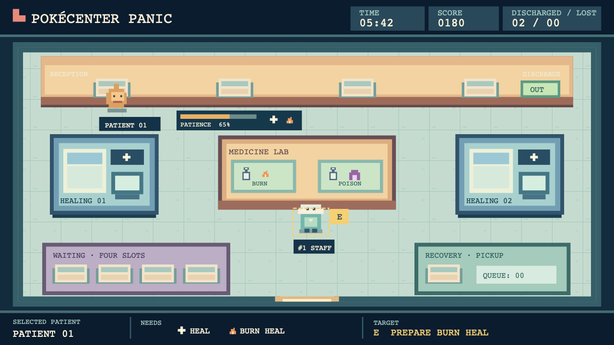

# MVP visual assets

This is the working art guide for the first Pokémon Center. The [editable visual pilot](visual-pilot.svg) is an original, self-contained composition used to evaluate scale, palette, station recognition, and HUD density at the minimum 1280 × 720 viewport. Its two character silhouettes are placeholders, not Pokémon art or production sprites.

## Baseline and scale

The current game uses a fixed 960 × 540 world, a 48-pixel logical tile, `Phaser.Scale.FIT`, and `pixelArt: true`. Keep those world dimensions for the first art integration so the shared movement geometry and interaction points continue to agree. The pilot has been rendered at 1280 × 720; final browser validation must still include actual PMD sprites, Chrome and Firefox, and a complete round.

PMD frame sizes in the locally generated manifest are not uniform:

| Species | Idle frame | Walk frame |
| --- | ---: | ---: |
| Pikachu | 40 × 56 | 32 × 40 |
| Bulbasaur | 32 × 40 | 40 × 40 |
| Charmander | 32 × 40 | 32 × 32 |
| Squirtle | 32 × 32 | 32 × 32 |
| Eevee | 24 × 32 | 40 × 48 |
| Psyduck | 24 × 40 | 24 × 40 |
| Chansey | 24 × 40 | 24 × 32 |
| Audino | 32 × 48 | 32 × 48 |
| Machoke | 32 × 48 | 32 × 48 |
| Meowth | 32 × 32 | 24 × 32 |

Render these at native 1× texture scale with their feet anchored to the world position. A frame may extend above its 48-pixel tile; its full image dimensions are not its collision bounds. Use the texture's nearest-neighbor sampling and sort entities by foot Y. This avoids per-species fractional shrinking and keeps the animation system shared. Confirm that names, carried patients, and station labels remain clear when the largest frame is present.

The pilot palette uses dark navy `#0a1c2e` for HUD panels, deep teal `#345e68` for walls, pale mint `#c6dbcf` for the floor, warm cream `#f2d3a1` for counters, cool blue `#729fb4` for healing, and lavender `#bbaec5` for waiting. Status icons must have distinct silhouettes and short text labels; color remains a secondary cue. Use the existing monospace fallback until any new font has been reviewed for source, license, and readability.

## Inventory

| Group | MVP resources | Source and delivery |
| --- | --- | --- |
| Characters | Six patient species and four selectable staff species; directional Idle and Walk where available | Existing PMD importer and ignored local cache; credit and release-rights review required |
| Floor and shell | Floor variants, wall edges/corners, doorway, trims, shadows | Original pixel art source and exported runtime tiles |
| Reception | Counter, four numbered arrival bays, separate discharge sign and target | Original art; layout and target positions come from shared map data |
| Healing | Two machines; empty, treating, completed, and broken appearances; progress and repair indicator | Original art and state overlays |
| Medicine | Table, Burn Heal and Antidote preparation points, disposal point, four dose surfaces | Original art; each point has a distinct icon and target state |
| Patient handling | Four waiting beds, recovery pickup area and queue count, generic stretcher | Original art; one stretcher works for every species |
| Doses | One generic bottle and separate burn/poison marks | Original bottle and icons; no species-specific carrying animation |
| Patient indicators | Injury, burn, poison, completed treatment, ready for discharge, patience bar | Original icons and code-rendered bars; pending treatments form an unordered checklist |
| Player and interaction UI | Slot number, name, focused target, E action, hold progress, rejection reason | Text and code-rendered panels/highlights with original icon accents |
| Round UI | Timer, score, discharged/lost counters, results, credits | Text and code-rendered panels; keep the whole map visible |
| Effects | Arrival, pickup, treatment finish, loss, machine outage, round end | Small original frame effects or Phaser tweens; all important states remain readable when muted |

## Integration contract

1. Keep original editable source art in the repository and export optimized runtime images under `apps/client/public/assets/original/`. A shared texture manifest should record dimensions, anchors, animation frames, and the source file. Do not commit downloaded PMD sheets or other third-party binaries.
2. Render floor, station bases, entities sorted by foot Y, foreground pieces, indicators, and HUD in that order. Patient and station art must reflect server state; animation never decides gameplay state.
3. Use one layout definition for visual placement, solid geometry, and interaction points. When Tiled or another editor is introduced, generate or validate the server collision data from the same layout rather than maintaining a second hand-positioned map.
4. Keep a provisional marker fallback when external character sprites are unavailable. The production build needs a reviewed source and credits entry for each external resource it ships.

## Visual checks

- **Pilot completed:** the SVG renders at 1280 × 720 with readable station labels, patient need icons, target prompt, and HUD without hiding the room.
- **Native-scale spot check completed:** a local round at 1280 × 720 showed Chansey staff and an injured Pikachu patient with readable names and crisp sprites. Their texture scale is 1×. The runtime screenshot stays local because it contains third-party character art.
- **Next integration check:** compare all native-size PMD frames in the actual Phaser scene, including Eevee's 40-pixel Walk frame. Check carriage, overlaps, and the fixed-camera viewport for every selectable character.
- **Release check:** complete the muted Chrome/Firefox walkthrough at 1280 × 720 required by `docs/specification.md` AC-21, and verify credits and distribution rights before a public build.

Related work is tracked on the PokéCenter Panic Trello board in the visual scale, environment art, medical feedback, and sprite rights cards.
